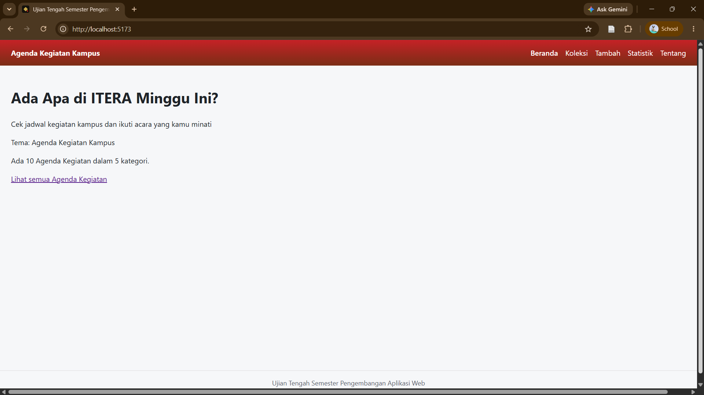
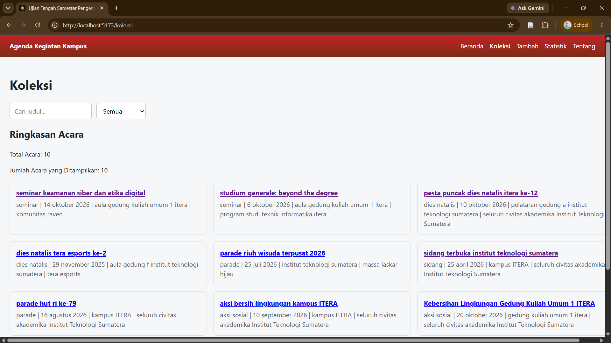
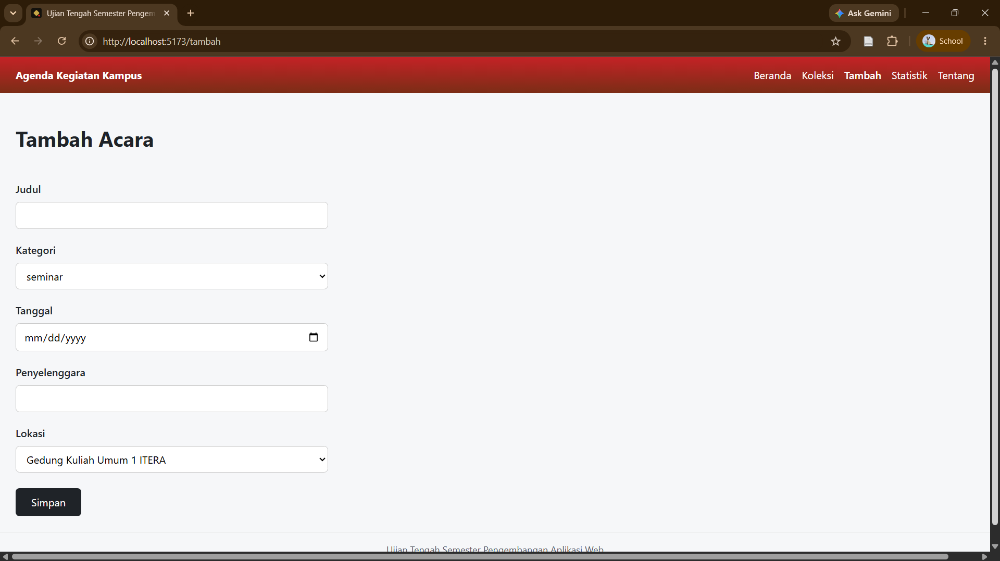
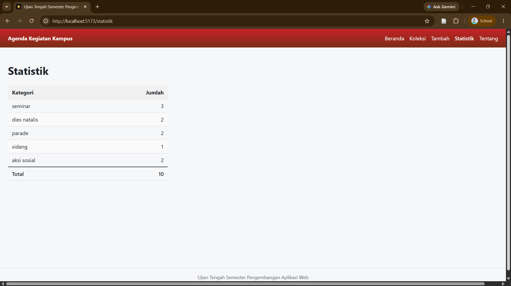
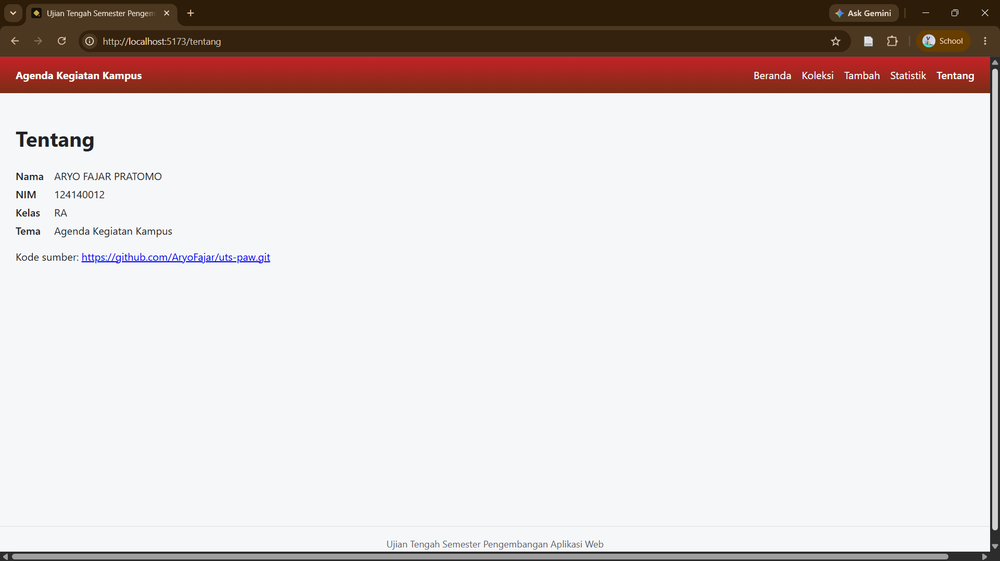
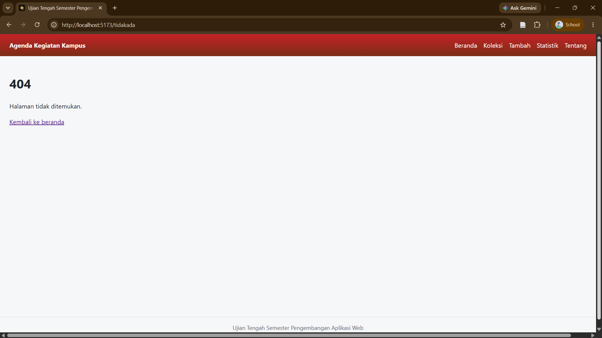

# Ujian Tengah Semester IF25-22014 Pengembangan Aplikasi Web

# Agenda Kegiatan Kampus

| Informasi | Detail |
| :--- | :--- |
| *Nama* | ARYO FAJAR PRATOMO |
| *NIM* | 124140012 |
| *Kelas* | RA |
| *Tema* | Agenda Kegiatan Kampus |
| *Deployment* | https://aryofajar.github.io/uts-paw/ |


---


## Tangkapan Layar Aplikasi




<p align="center" >Gambar 1. Halaman Beranda</p>



<p align="center" >Gambar 2. Halaman Koleksi</p>


<p align="center" >Gambar 3. Halaman Detail Koleksi</p>



<p align="center" >Gambar 4. Halaman Tambah</p>



<p align="center" >Gambar 5. Halaman Statistik</p>



<p align="center" >Gambar 6. Halaman Tentang</p>


<p align="center" >Gambar 7. Halaman Menampilkan 404</p>

---


## Fitur

- Menampilkan ringkasan dan daftar koleksi Agenda Kegiatan.
- Pencarian dan filter Kegiatan berdasarkan kategori.
- Melihat informasi lengkap Kegiatan pada halaman detail.
- Menampilkan Pesan "Tidak ada agenda yang ditemukan, coba tambahkan kategori lain atau ubah kata kunci pencarian." apabila kata kunci tidak ada
- Menambahkan Agenda Kegiatan baru ke dalam koleksi.
- Menghapus Kegiatan dengan konfirmasi
- Menampilkan statistik jumlah Kegiatan berdasarkan kategori.
- Menampilkan identitas mahasiswa, tema, dan juga link repo github di halaman tentang.
- Menampilkan Halaman  404

---


## Menjalankan secara lokal

```
cd app
npm install
npm run dev
```

---

## Konsep React yang dipakai

- Components & Props: Memecah antarmuka menjadi komponen modular yang dapat digunakan kembali.
- State Management (useState): Mengelola state lokal pada form input, validasi, dan filter pencarian.
- React Context (useContext & Custom Hook useKoleksi): Mengelola data koleksi agenda kegiatan secara global di seluruh halaman.
- React Router (react-router-dom): Navigasi multi-page (SPA) menggunakan useNavigate, useParams, dan <Link>.
- Testing dengan Vitest dan Testing Library.

---
